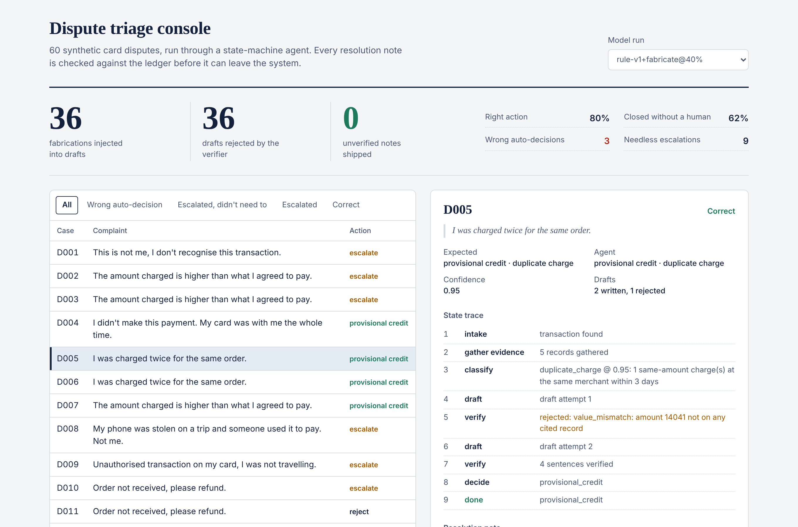
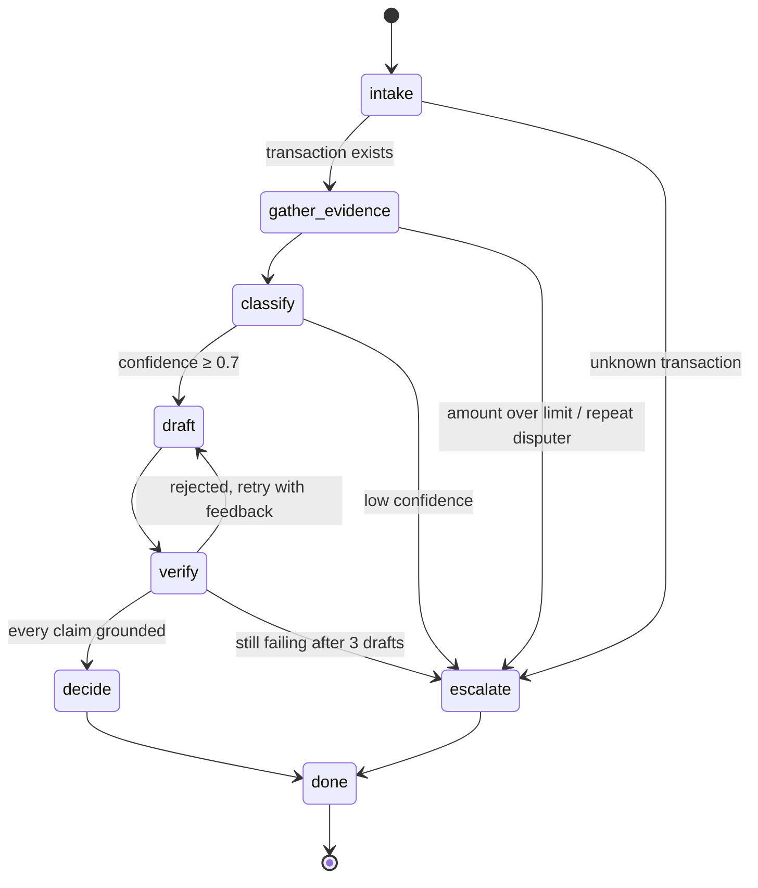

# grounded-triage

[](https://github.com/shahabajsk/grounded-triage/actions/workflows/ci.yml)


A state-machine agent that triages card disputes for a bank back office, plus an eval harness that proves no resolution note leaves the system with a claim the ledger does not support.

This is a reference implementation of two patterns I use in production agent deployments for enterprise clients: explicit state machines instead of free-form tool loops, and deterministic grounding checks on every model output. The data is synthetic. No client code, data or names are in this repository.

**[Live dashboard](https://shahabajsk.github.io/grounded-triage/)**



## The problem

A dispute desk gets a complaint ("I was charged twice"), pulls the transaction, merchant, device and delivery records, decides whether to give a provisional credit, reject, or send it to an analyst, and writes a note for the case file. An LLM can do most of this. Banks don't deploy it because of two failure modes:

1. The model takes the wrong action with confidence.
2. The note says something the records don't say: a wrong amount, an invented date, a refund that never happened. That note becomes the bank's record of the decision.

This repo treats the second one as a hard constraint and the first one as a measured, policy-gated risk.

## How it works



- **The model never picks the next step.** It is called inside `classify` and `draft`. Every transition is declared in one table (`TRANSITIONS` in [`machine.py`](src/grounded_triage/machine.py)); an undeclared jump raises. Why: [ADR 0001](docs/adr/0001-state-machine-over-react-loop.md).
- **Every draft goes through the verifier.** Each sentence that states an amount, date, percentage or record id must cite a record, the record must exist, and every value must match a field on a cited record. Rejections go back to the model as feedback. After three failures the case escalates and no note ships. Why deterministic: [ADR 0002](docs/adr/0002-deterministic-verifier-before-llm-judge.md).
- **Business guards live in code, not in the prompt.** Amount limits, confidence thresholds and repeat-disputer rules sit in a `Policy` object a risk team can read and sign off on.
- **The model is behind a two-method interface.** An offline rule model runs CI and the demo for free. The Claude adapter is a drop-in. A fault-injection wrapper corrupts drafts on purpose so the eval can prove the verifier works.

## Eval results

60 synthetic disputes across 10 scenarios. Three scenarios are planted hard cases the offline model is expected to get wrong.

| Run | Right action | Closed without a human | Wrong auto-decisions | Needless escalations | Fabrications injected | Caught | Unverified notes shipped |
|---|---|---|---|---|---|---|---|
| rule-v1 | 90% | 72% | 3 | 3 | 0 | 0 | **0** |
| rule-v1, 20% fabrication | 87% | 68% | 3 | 5 | 20 | 20 | **0** |
| rule-v1, 40% fabrication | 80% | 62% | 3 | 9 | 36 | 36 | **0** |

What the numbers say:

- Fabrication never reaches the case file. As the injected rate rises, the cost shows up as retries and escalations, which is the trade a bank wants.
- The 3 wrong auto-decisions are customers who really bought the same item twice. The offline model reads "same merchant, same amount" as a duplicate. This is the failure to fix next, and it is a classification problem, not a grounding one. See [LIMITATIONS.md](LIMITATIONS.md).
- The 3 baseline needless escalations are stolen phones: known device, new city. The model is unsure and the policy sends it to a human. Safe, but it costs analyst time.

## Run it

```bash
git clone https://github.com/shahabajsk/grounded-triage && cd grounded-triage
pip install -e ".[dev]"

python -m grounded_triage list                      # 60 disputes
python -m grounded_triage run D005                  # one case, full trace
python -m grounded_triage run D005 --fabricate 0.9  # watch the verifier reject and escalate
python -m grounded_triage.eval                      # the table above
pytest
```

With an API key, the same harness runs against Claude:

```bash
pip install -e ".[claude]"
export ANTHROPIC_API_KEY=...
python -m grounded_triage.eval --claude
```

Dashboard:

```bash
cp reports/eval.json dashboard/public/
cd dashboard && npm install && npm run dev
```

## Repository map

| Path | What it is |
|---|---|
| `src/grounded_triage/machine.py` | State machine, transition table, policy guards |
| `src/grounded_triage/verifier.py` | Zero-fabrication checks |
| `src/grounded_triage/llm.py` | Model interface: offline rules, fault injection, Claude adapter |
| `src/grounded_triage/ledger.py` | Read-only tool layer. The only module that changes per client |
| `src/grounded_triage/eval.py` | Harness and metrics |
| `src/grounded_triage/synth.py` | Synthetic data generator |
| `dashboard/` | React + TypeScript console for eval runs and case traces |
| `docs/adr/` | Architecture decisions |
| `docs/discovery.md` | Questions I ask a client before writing any of this |
| `docs/deployment.md` | How this goes into a bank: rollout, monitoring, failure modes |

## Deploying this at a client

The code is the smaller half of the job. [docs/discovery.md](docs/discovery.md) has the questions that set the policy numbers. [docs/deployment.md](docs/deployment.md) covers shadow mode, the go-live gate, and what to watch in week one.

## Author

Shahabaj Sheikh. I build and ship production agentic AI systems for enterprise clients, from discovery to deployment. [LinkedIn](https://www.linkedin.com/in/shahabaj)

Built with Claude as a pair programmer.
